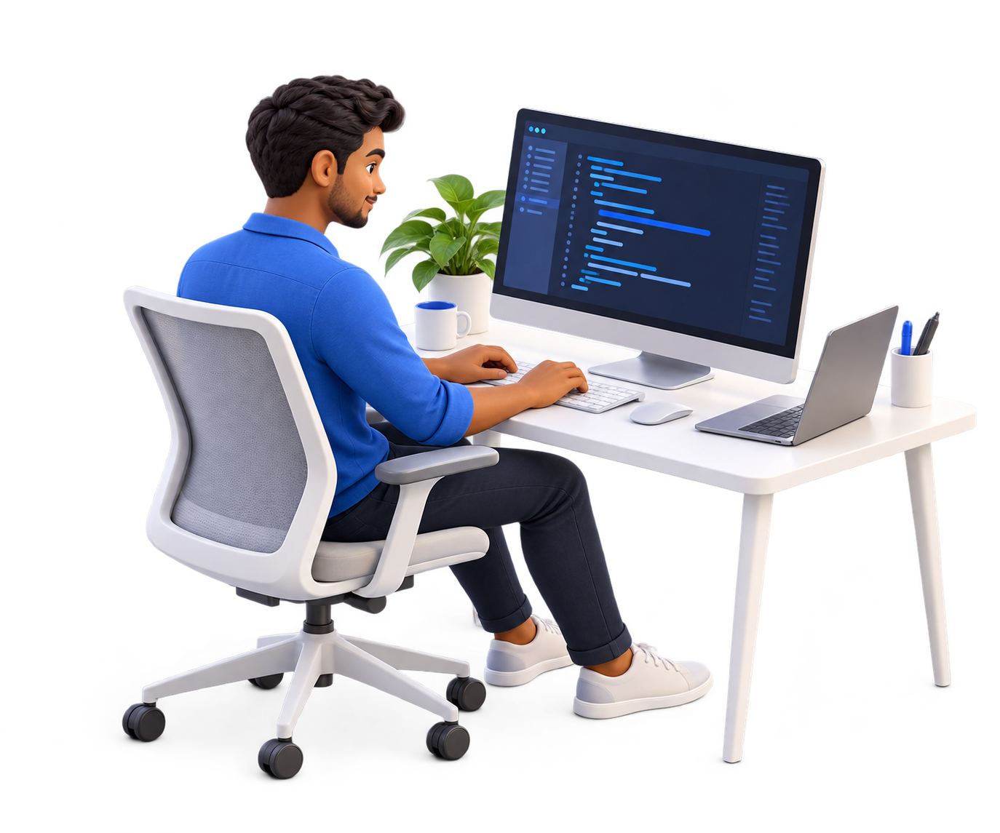

<picture>
  <source media="(prefers-reduced-motion: reduce) and (max-width: 600px)" srcset="./assets/hero-mobile-preview.png" />
  <source media="(prefers-reduced-motion: reduce)" srcset="./assets/hero-preview.png" />
  <source media="(max-width: 600px)" srcset="./assets/hero-mobile.gif" />
  
</picture>

**Full Stack Developer at TechSmew Technologies · Coimbatore, India**

[Connect on LinkedIn](https://www.linkedin.com/in/nishan45/)

 

## Practical AI. Connected systems.

I work on **AI document processing**, **backend services**, and **cloud integrations**. My interests include OCR, model integration, and the engineering that connects AI to useful applications.

 

## Engineering toolkit

| Layer | Technologies I work with |
| :--- | :--- |
| **AI development tools** | Claude Code · Codex · Google Antigravity |
| **Document AI** | PaddleOCR · Qwen2.5-VL · vLLM |
| **Backend & messaging** | Python · Java · Node.js · FastAPI · Apache Kafka · Keycloak |
| **Data & search** | PostgreSQL · MySQL · MongoDB · Redis · OpenSearch |
| **Cloud & delivery** | AWS · Docker · Git · Bash |

 

**Background:** B.Sc. in Physics → software development.

 

**Let's talk about software, systems, and AI.**

[Connect on LinkedIn](https://www.linkedin.com/in/nishan45/)

Nishan · @nishan4545

