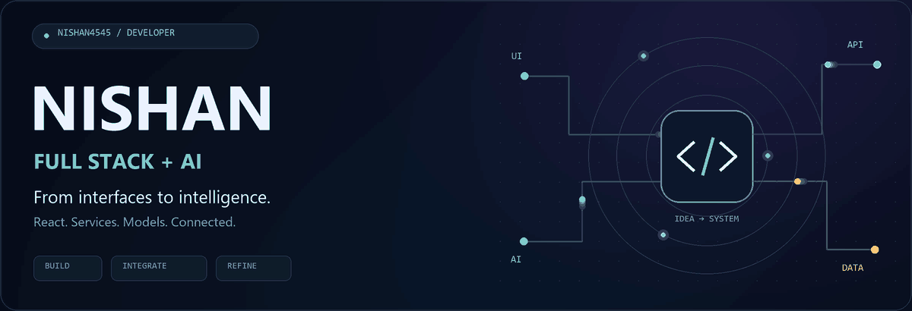

<a href="https://nishan4545.github.io/nishan4545/">
<picture>
  <source media="(prefers-reduced-motion: reduce) and (max-width: 600px)" srcset="./assets/hero-mobile-preview.png" />
  <source media="(prefers-reduced-motion: reduce)" srcset="./assets/hero-preview.png" />
  <source media="(max-width: 600px)" srcset="./assets/hero-mobile.gif" />
  
</picture>
</a>

**Full Stack Developer at TechSmew Technologies · Coimbatore, India**

[**Explore my interactive profile ↗**](https://nishan4545.github.io/nishan4545/) &nbsp; · &nbsp; [Connect on LinkedIn](https://www.linkedin.com/in/nishan45/)

 

## Interfaces. Services. Intelligence.

Hi, I'm **Nishan**. I work on full-stack applications and AI document-processing workflows, connecting **React interfaces**, **backend services**, **databases**, and **AI models**.

My experience spans business applications, microservices, OCR, and cloud deployment. I'm interested in the engineering that turns these parts into useful software.

 

## Engineering toolkit

| Layer | Technologies I work with |
| :--- | :--- |
| **Languages** | JavaScript · Python · Java |
| **Interfaces** | React · HTML · CSS · Vite · Tailwind CSS · Redux |
| **Services & messaging** | Node.js · FastAPI · Apache Kafka · Keycloak |
| **Data & search** | PostgreSQL · MySQL · MongoDB · Redis · OpenSearch |
| **Document AI** | PaddleOCR · Qwen2.5-VL · vLLM |
| **Cloud & delivery** | AWS · Docker · Git · Bash |
| **AI development tools** | Claude Code · Codex · Google Antigravity |

 

## Beyond the stack

- **Current work:** Full-stack development and AI document processing at TechSmew Technologies.
- **Background:** B.Sc. in Physics; now working in software development.
- **Interests:** Backend systems, model integration, and practical AI applications.

 

**Let's talk about software, systems, and AI.**

[Connect on LinkedIn](https://www.linkedin.com/in/nishan45/)

Nishan · @nishan4545

