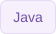

<picture>
  <source media="(prefers-reduced-motion: reduce) and (max-width: 600px)" srcset="./assets/intro-light-mobile-preview.png" />
  <source media="(prefers-reduced-motion: reduce)" srcset="./assets/intro-light-preview.png" />
  <source media="(max-width: 600px)" srcset="./assets/intro-light-mobile.gif" />
  
</picture>

<picture>
  <source media="(prefers-reduced-motion: reduce)" srcset="./assets/developer-hello-work-preview.png" />
  
</picture>

**Full Stack Developer · Coimbatore, India**

[Connect on LinkedIn](https://www.linkedin.com/in/nishan45/)

 

## Practical AI. Connected systems.

I work on **AI document processing**, **backend services**, and **cloud integrations**. My interests include OCR, model integration, and the engineering that connects AI to useful applications.

 

## Engineering toolkit

**AI development tools**

  
  
  

**Document AI**

  
  
  

**Backend & messaging**

  
  
  
  
  
  

**Data & search**

  
  
  
  
  

**Cloud & delivery**

  
  
  
  

 

**Background:** B.Sc. in Physics → software development.

 

**Let's talk about software, systems, and AI.**

[Connect on LinkedIn](https://www.linkedin.com/in/nishan45/)

Nishan · @nishan4545

